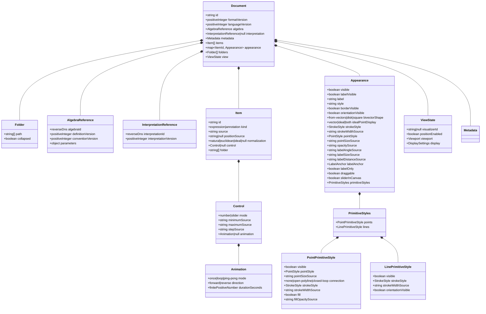
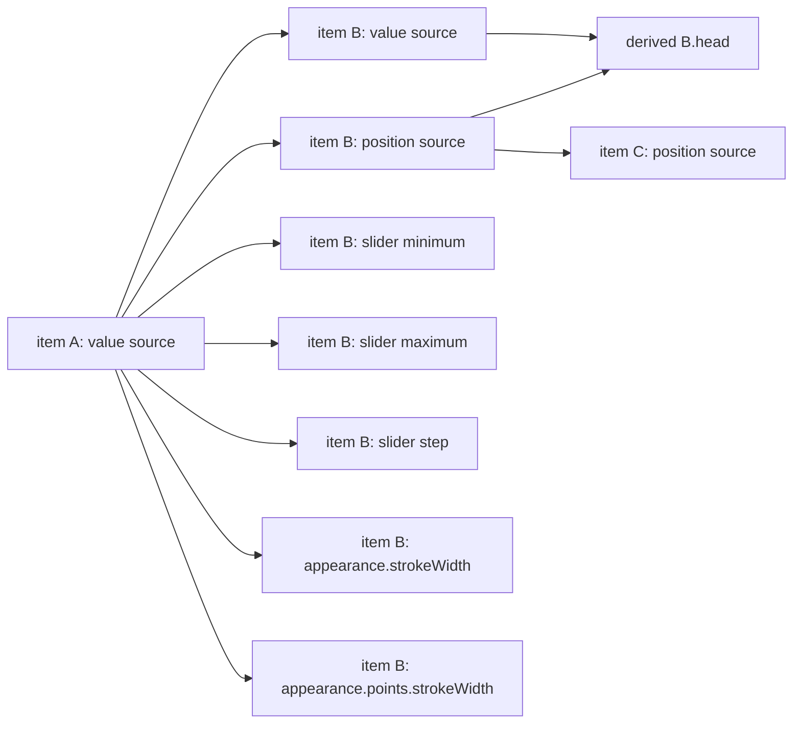

# GAMUT Document Format

**Status:** Draft for review
**Date:** 2026-07-30
**Format version:** 1
**Refines:** DOC-001 through DOC-014
**License:** MIT

## 1. Purpose and authority

This document specifies the serialized document structure, canonical JSON rules,
validation boundary, and dependency-node model for format version 1. All local,
imported, exported, shared, and example documents use this structure.

Stored source is authoritative. Tokens, abstract syntax trees, evaluated values,
render primitives, active playback, transient selection, focus, dialog state,
and undo or redo stacks are derived or session state and are never serialized.

Persisted reverse-DNS identifiers such as `org.multivector.vga`,
`org.multivector.pga`, and their interpretation and visualizer identifiers are
stable opaque protocol values. Their namespace records the project's history
and is independent of the current product name. A product rename alone shall
never change them or require a document-format migration.

### Current implementation subset

The in-memory expression document currently owns stable item identities, value
source, and an optional separate position source. Value and position sources
are evaluated as distinct dependency nodes for interpreted single vectors and
single bivectors; lists inherit element positions, and other value kinds
preserve position source without activating it.

The current in-memory subset also owns sparse item-keyed appearance records:
visibility, label visibility, label text, and style may each be absent, and one
resolver supplies the deterministic defaults. These sparse records are
application state, not canonical JSON; a canonical `Appearance` contains every
required field described in section 2.2. A common list record applies to every
rendered element. Natural normalization
is modeled by the canonical nullable `normalization` field on an expression
item. It changes the value seen by dependent expressions without rewriting
source and remains separate from appearance and numeric controls. The current
theme selector updates display tokens immediately and populates and restores
canonical `ViewState.display.theme`.

The current document operations include an atomic clear transition. It replaces
`items` with an empty array and `appearance` with an empty object while retaining
all document-level identity and configuration fields. The sustained-hold
confirmation and subsequent focus restoration are interface behavior and are
not serialized.

Canonical JSON serialization, strict version-one validation, local persistence,
and explicit JSON import and export are implemented. Imports whose identity
collides with the open document offer replacement or duplication; duplication
regenerates the document and every item identity while preserving ordered
canonical content. Dropping one `.json` file (including `.gamut.json` and
`.multivector.json`) or one `application/json` file onto the application
window imports it through the same path, with the same limits, migration,
validation, collision choice, and diagnostics; a temporary scene-link session
stays temporary. A drop of several files (`DOCUMENT_DROP_MULTIPLE`) or of a
file that is not JSON (`DOCUMENT_DROP_TYPE`) is rejected before any file is
read and leaves the open document unchanged; a drag that carries no file is
left to the page. One `.zip` file is a library archive and takes the path of
**Import library** instead (STORE-018). Appearance, natural
normalization, source, position source, document identity, metadata, and theme
round-trip through that boundary. Numeric-control records are validated and
preserved through the nullable `control` field and drive scalar controls without
serializing evaluated bounds, transient slider state, or active playback state.
Animation mode, direction, and duration are persisted configuration; elapsed
time and playback status are derived application state. Annotation source is preserved as
non-executable content and never enters parsing or evaluation. Both closed
viewport variants restore deterministically: `none` disables the visualizer,
while the supported two-dimensional record restores center and zoom. An
unsupported visualizer/viewport combination remains in the document and
produces an explicit recovery diagnostic. Viewport display controls do
not yet have dedicated editing interfaces. Annotations are written as notes:
`kind` is stored and changes only by an explicit conversion (language §3),
never by a source edit, and the conversion to an annotation sets
`positionSource`, `normalization`, and `control` to `null`. The source of an
annotation is its text, without any marker (format version 9; version 8 kept
a leading `#`, decided on 2026-10-11 in #187 and replaced on 2026-11-16). The format version
7 appearance fields and list primitive styles are validated, migrated, and
preserved. `strokeStyle`, `strokeWidthSource`, `opacitySource`,
`pointStyle`, `pointSizeSource`, both `primitiveStyles` blocks, and the label
settings affect the drawing. A label distance is the radius of the circle,
around the label's anchor point, on which the eight positions lie: `right` is
the distance to the right, and `top-right` the distance divided by √2 along
each axis (format version 12; earlier releases offset a diagonal label by the
distance along each axis). A set label size or distance is multiplied by
`objectScale`; the empty defaults are a fixed 13-pixel font and a fixed
20-pixel radius (8 pixels before format version 12). A label angle, in
radians from format version 12 (degrees before), turns the label
counterclockwise about the centre of its text; angles 2π apart are the same. `auto` estimates each label's box from its
text and tries the eight positions from `top-right` clockwise, avoiding other
labels and the points and handles of other objects, and, when it can, the
inside of every filled point list, its own included: a position clear of
labels, points and handles comes before one outside the fills. Appearance sources are
evaluated after the value nodes they read, which is equivalent to the graph
order of section 5 since no source can reference them. An item with no
stored `orientationVisible` is saved with its kind's default: hidden for a
line, shown otherwise. The `natural`, `euclidean`, and `ideal` normalization
modes are chosen from the expression row (*auto*, *norm*, *inorm*; VGA offers
off and auto only) and evaluated as described in section 2.2. This note records
implementation evidence and does not change the normative serialized structure
below.

## 2. Structure

GitHub renders the following Mermaid diagram. The field tables below, rather
than the diagram layout, are normative.

Every object listed below is closed: an unknown field is invalid in format
version 1. A required nullable field shall be present even when its value is
`null`.

Later format versions may introduce explicitly named extension containers under
DOC-011. Format version 1 defines none. Implementations shall never treat an
unknown field as an implicit extension.

### 2.1 Document

| Field | Type | Rule |
| --- | --- | --- |
| `id` | string | Non-empty opaque immutable document identity. |
| `formatVersion` | positive integer | Exactly the current version (`13`) after migration (section 4.1). |
| `languageVersion` | positive integer | Exactly the current language version (`2`) after migration; selects source syntax and semantics. Version 1 sources are rewritten on load (language section 15); a later version is refused with `DOCUMENT_LANGUAGE_VERSION`. |
| `algebra` | `AlgebraReference` | Selects one validated algebra configuration. |
| `interpretation` | `InterpretationReference \| null` | At most one active interpretation. |
| `metadata` | `Metadata` | Descriptive, non-executable document metadata. |
| `items` | `Item[]` | Ordered; item identities shall be unique. |
| `appearance` | object | Keys are item identities and values are `Appearance`; no orphan key is valid. |
| `folders` | `Folder[]` | From format version 8: every expression folder with its collapsed state (section 2.4). |
| `view` | `ViewState` | Persistent presentation state. |

`Metadata` has exactly `title` and `description`, both strings. These fields
have no language or markup semantics.

`AlgebraReference` has exactly `algebraId`, `definitionVersion`,
`conventionVersion`, and `parameters`. Identifiers and versions follow DOC-010.
`parameters` is a closed definition-owned JSON object validated and
canonicalized before the document enters application state.

`InterpretationReference` has exactly `interpretationId` and
`interpretationVersion`. Its identifier is a lowercase reverse-DNS identifier
and its version is a positive integer.

### 2.2 Items, appearance, and controls

An `Item` has exactly `id`, `kind`, `source`, `positionSource`, `normalization`,
and `control`, and, from format version 8, the optional `folder` of section
2.4. Its identity is a non-empty opaque immutable string. `kind` is
`expression` or `annotation`; `source` is stored verbatim. An annotation
requires `positionSource`, `normalization`, and `control` to be `null`.

`positionSource` is either `null` or source text stored verbatim. It is preserved
when position support is disabled. When enabled, it participates in the
dependency graph described below. Position support is disabled only without a
visualizer (NoViz, #55), where nothing is drawn: a document opened with a
visualizer applies its positions even if it stored `positionEnabled: false`,
and writing a non-empty position enables position support in the same command.

`normalization` is `null`, `natural`, `euclidean`, or `ideal`. `natural`
requests the active algebra's versioned natural-normalization service after
evaluating the item's source and before dependent expressions resolve it; in
PGA it divides a value classified Euclidean by `norm` and a value classified
ideal by `inorm`. `euclidean` and `ideal` force the Euclidean norm `norm` or
the ideal norm `inorm` (PGA convention §7). When normalization is unavailable,
the service returns the unchanged value according to the algebra convention.
The field does not rewrite source and is independent of appearance and
`control`; it is chosen from the item's expression row, not from the
appearance menu.

`control` is `null` or an object with exactly `mode`, `minimumSource`,
`maximumSource`, `stepSource`, and `animation`. `mode` is `number` or `slider`.
The three sources are stored verbatim and use the common language. An empty
source is derived from the scalar's value `t`: the maximum is `t` when
`t > 10` and `10` otherwise, the minimum is `t` when `t < −10` and `−10`
otherwise, and the step is a hundredth of the interval. A derived bound never
meets a given one: it lies 20 beyond it instead. A new slider starts with the
three sources empty; a drag or a playback keeps the derived interval it
started with.
`animation` is `null` or an object with exactly `mode`, `direction`, and
`durationSeconds`, using the values shown in the diagram. Active playback and
its source snapshot are not stored. Animation may be configured in either
control mode; both modes use the same minimum, maximum, step, and animation
fields, and changing `mode` preserves them. A control acts only while the item
source declares a numeric literal; otherwise it is preserved but dormant, like
`positionSource` when position support is disabled, and becomes active again
when the source returns to a literal.

An `Appearance` has exactly the fields of the diagram above. `visible`,
`labelVisible`, `borderVisible`, and `orientationVisible` are booleans.
`label` is stored plain text; an empty value uses the deterministic semantic
default. When drawn, each `${expression}` in it is replaced by the value of
the expression, evaluated like an appearance source and formatted like the
values of the panel; one that cannot be evaluated shows `?`. `\$` writes a
dollar sign. Any other `$` is reserved for inline math: it is drawn as
written for now, with a warning, and a later format version may read it
differently. `style` is a registered non-empty, palette-independent style
identifier. `bivectorShape` and `idealPointDisplay` take the values of the
diagram. Appearance is item-level; list elements do not have independent
stored appearance, and the primitives of a list are styled per primitive type
(section 2.2.2).

`strokeStyle` is `solid`, `dashed`, or `dotted`, and applies to every stroked
drawing of the item: lines, vectors, bivector outlines, and ideal-point
arrows. `pointStyle` is `dot`, `ring`, `cross`, `plus`, `square`, or
`diamond`. `labelAnchor` is `auto`, one of the eight positions `top-left`,
`top`, `top-right`, `left`, `right`, `bottom-left`, `bottom`, and
`bottom-right` around the label's anchor point, or `center`, which centres the
label on that point and ignores the label distance; `auto` places the label at
the first of the eight positions where it overlaps nothing, never at the
centre. `labelOnly` true, while `labelVisible` is true, draws the label without
its object: the object is drawn at zero opacity, so it keeps its handles and
can still be moved. It has no effect while the label is hidden. `draggable`,
`true` for new objects, says whether the handles of an object that a drag can
move (a point, a vector or a line whose source a drag rewrites) move it on the
canvas; `false` holds it in place, with no handle, and changes nothing else.
It is set per row: a folder that overwrites the appearance of its rows leaves
it to each row. `sliderInCanvas`, `false` for new objects, draws the slider of
a scalar that declares a numeric literal on the canvas as well as in its row,
with the same bounds, step and animation; it has no effect on any other
value, and is also set per row.

The fields whose names end in `Source` are **appearance sources**: numeric
settings stored verbatim as source text, like the bounds of a numeric control.
A source is a number (`2.4`) or a scalar expression (`w`) of the common
language. **An empty source selects the default of the object kind.** A
non-empty source is evaluated as a dependency node (section 5); a value that
is not a finite real scalar, or lies outside the range below, falls back to
the kind default with a diagnostic and never makes the document invalid.

| Field | Unit | Range | Empty source |
| --- | --- | --- | --- |
| `strokeWidthSource` | reference px | any, below 0 drawn as 0 | kind default |
| `pointSizeSource` | reference px | any, below 0 drawn as 0 | kind default |
| `opacitySource` | % | 0 to 100 | 100 |
| `labelAngleSource` | radians | any, brought into (−π, π] | 0 |
| `labelSizeSource` | reference px | any, below 0 drawn as 0 | 13 |
| `labelDistanceSource` | reference px | any, below 0 drawn as 0 | kind default |

Ranges are inclusive and owned by the
[limits and interaction constants](limits-and-constants.md). Pixel values are
reference screen pixels multiplied by the document's `objectScale`, like the
fixed sizes they replace. A kind default is the value drawn before format
version 7 (for example a point radius of 4.5 reference pixels), so an empty
source never changes a drawing; the label distance is the exception, 20 pixels
from format version 12. A vector, and the arrow of an ideal point, take their size from
`pointSizeSource`, in the units of a point's size: the base is drawn as the
point of that size, and the shaft, arrowhead and head point grow in
proportion. A vector without a size that keeps a `strokeWidthSource`, as
documents saved before sizes do, is sized by that shaft width instead.
Opacity applies to fill and stroke together. A list has no label: its
label fields are stored and ignored.

New objects default to `strokeStyle: solid`, `pointStyle: dot`, empty sources,
and `labelAnchor: auto`.

#### 2.2.1 Initial style registry

The registry contains six ordered shades in each of nine semantic ramps, in
this order: `red`, `orange`, `yellow`, `green`, `teal`, `blue`, `purple`,
`pink`, and `neutral`, from `red-1` through `neutral-6`. Format versions 1
through 6 registered `red`, `blue`, `green`, `yellow`, and `neutral`; format
version 7 adds `orange`, `teal`, `purple`, and `pink`. These identifiers are
canonical document data. Their concrete color values are renderer-owned and
are not serialized.

When an item has no stored style, the current VGA interface applies these
deterministic defaults:

| Semantic kind | Style identifier |
| --- | --- |
| Scalar | `green-4` |
| Vector | `yellow-4` |
| Bivector | `red-4` |
| Rotor | `blue-3` |
| Mixed multivector | `blue-4` |
| List | `green-3` |
| Unregistered semantic kind | `blue-4` |

Canonical validation rejects an unregistered style identifier. A renderer may
use `blue-4` as a defensive display fallback for invalid or pre-validation
in-memory data, but that fallback never makes the record canonically valid.
For a scalar or another non-spatial value, style affects its expression-panel
presentation only; visibility and visualizer-label controls are unavailable.

#### 2.2.2 List primitive styles

`primitiveStyles` has exactly `points` and `lines`, one block per primitive
type a list can contain. It applies only when the item evaluates to a list,
and is stored, with its defaults, on every record so that a source edit that
turns a value into a list never needs a migration. A list's `style` colors
every primitive it holds; there is no list-wide stroke or point setting and no
inheritance between the item fields and the blocks. An interface shows a block
only for a primitive type the evaluated list contains.

- `points`: `visible` (whether the point markers are drawn), `pointStyle`,
  `pointSizeSource`, `connection` (`none`, `open-polyline`, or `closed-loop`:
  the border, joining the markers in evaluated list order), the
  `strokeStyle` and `strokeWidthSource` of the border, `fill` (whether the
  polygon of the points is tinted with the list's color, when it has at least
  three points and all of them are finite; the polygon is closed whatever the
  border), and `fillOpacitySource`, the share of the color in percent, from 0
  to 100, like `opacitySource` (empty: 20). The three parts are drawn
  independently.
- `lines`: `visible`, `strokeStyle`, `strokeWidthSource`, and
  `orientationVisible`.

Their sources follow the rules of the item's appearance sources. Defaults are
`visible: true`, `pointStyle: dot`, `connection: none`, `strokeStyle: solid`,
empty sources, and, for lines, the item's `orientationVisible`.

### 2.3 View state

`ViewState` has exactly `visualizerId`, `positionEnabled`, `viewport`, and
`display`. `visualizerId` is a stable visualizer identifier or `null`.
`positionEnabled` is a boolean and can be true only when the selected
interpretation and visualizer advertise position support.

Format version 1 supports these closed `viewport` variants:

- `{ "kind": "none" }` when no visualizer is active, as in the NoViz
  calculator (`visualizerId: null`, `positionEnabled: false`), which the
  application enters and leaves from the canvas and the expression panel;
- `{ "kind": "two-dimensional", "centerX": number, "centerY": number,
  "zoom": number }`, where all numbers are finite and `zoom` is positive.

A document that pairs `visualizerId: null` with a two-dimensional viewport, a
visualizer with the `none` viewport, or names a visualizer or interpretation
this runtime does not provide, is preserved as stored and opens with its
diagnostic. The application shows it like the NoViz calculator, whose
**Show canvas** button rewrites the view to the algebra's standard visualizer
(keeping a stored two-dimensional viewport) and, when the interpretation is
unavailable, selects the algebra's standard interpretation in an undoable
step.

`DisplaySettings` has exactly `decimalPlaces`, `axisLabelsVisible`,
`graduationsVisible`, `gridVisible`, `objectScale`,
`showApproximatedResidue`, and `theme` in format versions 4 through 7,
additionally `valuesVisible` from format version 8, and `labelsVisible` from
format version 12.
`decimalPlaces` is an integer from 0 through 15 and defaults to 4 for new
documents. It controls presentation only: trailing zeroes are omitted, negative
zero is displayed as zero, and a non-zero magnitude that would round to zero is
shown in scientific notation. `objectScale` is finite and positive, the
visibility fields are booleans, and `theme` is `light`, `dark`, or `system`.
`showApproximatedResidue` is a boolean, `false` for new documents: when it is
`false`, a printed value omits the coefficients that the classification
tolerance of the document's interpretation treats as residue (VGA-INT-005,
PGA-INT-005); it never changes a computed value.
`valuesVisible` is a boolean, `true` for new documents: when it is `false`,
the multivector value under each expression, and under each element of an
expanded list, is hidden as specified by DOC-014
([#191](https://github.com/eharquin/gamut/issues/191)). Each affected row
announces its value as hidden (A11Y-013) and never exposes the hidden
coefficients through its accessible name, description, or live announcements.
Descriptions, diagnostics, controls, and the drawing are unchanged, and
turning the setting back on reveals every value at once. Like the other
display settings, it is saved, exported, and carried by scene links and
library graphs; it is a teaching aid, not a protection: the values remain in
the document.
`labelsVisible` is a boolean, `true` for new documents: when it is `false`, the
canvas draws no label, and an object set to `labelOnly` is drawn as usual;
the expression rows hide their label line and the appearance menu disables its
label switch.
Each item keeps its own `labelVisible`, which shows again when the setting is
turned back on.
Later format versions may add viewport variants through migration.

### 2.4 Expression folders

From format version 8, a document may group its items in expression folders
(DOC-013), as decided in [#83](https://github.com/eharquin/gamut/issues/83):

- each item carries the list of folder names that contains it, from the root,
  in the optional field `Item.folder` (for example
  `"folder": ["Triangle", "Angles"]`); an absent or empty list means the top
  level, and the canonical form omits the field for an item at the top level;
- the collapsed state of folders is stored separately in the document, not on
  the items, in the required field `Document.folders`: an array of closed
  `Folder` objects with exactly `path`, the non-empty list of folder names
  from the root, and `collapsed`, a boolean. `folders` lists every folder,
  empty ones included; its order only orders the folders that hold no item;
- a folder name is stored plain text with no markup semantics and may contain
  `/`; it is never empty, and two folders with the same parent never share a
  name, so a name list identifies one folder. A path appears at most once in
  `folders`, the parent of every listed folder is listed, and every
  `Item.folder` names a listed folder;
- the order of `items` stays the item order used for the canvas draw order and for every other order-dependent rule of
  this document; a folder never changes evaluation, appearance, position, or
  dependency nodes (section 5). Since forward references resolve
  ([language](language.md)), moving an item never invalidates a reference
  and never rewrites source;
- objects are closed and nesting depth, folder count, and name length obey
  the [folder limits](limits-and-constants.md#21-folders); folders do not
  count towards the 1,000 items per document;
- the collapsed state is document content, serialized and compared like other
  fields, so changing it is an unsaved change; it is not an undo entry.

The expression panel shows the tree in item order: a folder sits at the
position of its first item, and a folder that holds no item, directly or in a
subfolder, follows the other rows of its parent in the order of `folders`.
The commands that create, rename, remove, and move keep the items of every
folder contiguous in `items`, so the panel shows the rows in item order;
a document whose folder items are not contiguous is valid and shown with the
same rule. Removing a folder moves its items and subfolders to its parent
without changing the item order; it is refused when a subfolder has the name
of a folder already in the parent. Deleting a folder with its contents
([#364](https://github.com/eharquin/gamut/issues/364)) removes the folder,
every subfolder, and every item they hold, with the items' appearance, and is
never refused for a name. The order of the remaining items is unchanged; an
empty folder that showed before a deleted item shows before the first
remaining item that followed it, and a parent folder the deletion empties
keeps its place. Like every other command, it is one history step.

Validation fails with `DOCUMENT_FOLDER_NAME` for an empty name or path,
`DOCUMENT_DUPLICATE_FOLDER` for a path listed twice, `DOCUMENT_ORPHAN_FOLDER`
for a folder whose parent is not listed or an item whose folder is not
listed, and the `LIMIT_FOLDER_*` diagnostics of the folder limits. A document
without folders has `"folders": []` and all its items at the top level in
their stored order. A version 8 document written before folders joined that
version, without `folders`, migrates as having none.

## 3. Canonical JSON

A canonical document is encoded as UTF-8 JSON without a byte-order mark,
insignificant whitespace, or a trailing newline. Object keys are ordered by
Unicode code point. Array order is preserved. Strings use JSON escaping and are
not Unicode-normalized.

Numbers use the shortest decimal representation that round-trips to the same
finite IEEE 754 binary64 value. Negative zero is emitted as `0`. `NaN`,
infinities, duplicate JSON keys, lone surrogate code points, and integers outside
the safe integer range are invalid. Version fields and bounded integer settings
shall additionally satisfy their field rules.

Canonicalization is idempotent: canonicalizing canonical bytes returns the same
bytes. Import followed by export without a document mutation shall therefore be
byte-stable.

## 4. Validation and migration

Shared fragments and raw JSON imports have distinct bounded preprocessing
pipelines.

The concrete envelope and its temporary-session behavior are defined in
[Self-contained scene links](scene-links.md).

A shared fragment is processed in this order:

1. enforce the encoded shared-fragment size limit before decoding;
2. decode the bounded share envelope and validate its version and declared
   compression/encoding identifier;
3. verify the envelope integrity check before decompressing or interpreting its
   payload as a document;
4. decompress, when applicable, while enforcing both the expansion-ratio and
   decoded-document-size limits;
5. obtain the complete JSON bytes.

A raw JSON import is processed in this order:

1. enforce the decoded-document-size limit directly on the input bytes;
2. decode those bytes as strict UTF-8.

Both paths then enter the same document-processing pipeline:

1. parse JSON while rejecting duplicate keys and invalid scalar values;
2. read only `formatVersion` to select a trusted migration;
3. migrate one version at a time without evaluating source;
4. migrate the sources of a `languageVersion` 1 document to the current
   language, parsing but not evaluating them (language section 15);
5. validate the complete current schema and resource limits;
6. resolve the algebra and optional interpretation;
7. build dependency nodes, parse source, and evaluate.

The encoded shared-fragment limit does not apply to raw JSON imports. Neither
preprocessing path may pass partial, integrity-failing, malformed, or
over-limit JSON to the common pipeline.

### 4.1 Format version history

Each version adds required fields with a deterministic migration from the
previous one; the implementation records the migrations in
`src/document/canonicalDocument.ts`.

| Version | Change |
| --- | --- |
| 1 | The schema of this document. |
| 2 | `Appearance.borderVisible`. |
| 3 | `Appearance.orientationVisible` and `Appearance.bivectorShape` (`from-vectors`, `disk`, `square`). |
| 4 | `ViewState.display.showApproximatedResidue`; earlier documents always showed residue. |
| 5 | `Appearance.idealPointDisplay` (`vector`, `ideal`, `both`): how an ideal PGA point is drawn; earlier documents default to `vector`. |
| 6 | `Appearance.pointListDisplay` (`none`, `open-polyline`, `closed-loop`) and `Appearance.pointMarkersVisible`: how the elements of a list of finite and ideal points are connected, and whether a connected one keeps its point markers; earlier documents default to `none` with markers. |
| 7 | Appearance sources (`strokeWidthSource`, `pointSizeSource`, `opacitySource`, `labelAngleSource`, `labelSizeSource`, `labelDistanceSource`), `strokeStyle`, `pointStyle`, `labelAnchor`, and `primitiveStyles`; `Item.normalization` adds `euclidean` and `ideal`; the style registry adds `orange`, `teal`, `purple`, and `pink`. The migration fills empty sources, `solid`, `dot`, and `labelAnchor: top-right` (the fixed position of earlier versions), and moves `pointListDisplay` to `primitiveStyles.points.connection` and `pointMarkersVisible` to `primitiveStyles.points.visible`, kept `true` for an unconnected list, which always drew its markers; `primitiveStyles.lines.orientationVisible` copies the item's orientation. Normalization is unchanged. |
| 8 | `ViewState.display.valuesVisible` ([#191](https://github.com/eharquin/gamut/issues/191)); earlier documents always showed their values, so the migration sets `valuesVisible: true`. Expression folders ([#83](https://github.com/eharquin/gamut/issues/83)): the optional `Item.folder`, the item's folder name list, and `Document.folders`, every folder with its `path` and `collapsed` state (section 2.4); the migration adds `folders: []`, so every item stays at the top level in its current order. |
| 9 | The source of an annotation is its text only: `kind` is stored and no longer follows from a leading `#`. Version 8, which was never released, kept that `#` in the source; the migration removes the first `#` of each annotation and the whitespace around its text, which is the text version 8 displayed, so that it does not become a heading. Expressions are unchanged. |
| 10 | Each `Folder` gains `overwriteAppearance`, a boolean, and `appearance`, `null` or a complete `Appearance` record (section 2.2). `appearance.visible` false hides every item of the folder; the rest of the record is drawn instead of that of its items while `overwriteAppearance` is true, except the label fields. The migration sets `overwriteAppearance: false` and `appearance: null`. |
| 11 | Each `Folder` gains `before`, `null` or an item identity: a folder whose subtree holds no item shows just before the row, or the folder, that holds that item at its level; empty folders before one item keep the order of `folders`. With items, a folder shows at its first item and `before` is ignored; `null`, or an identity that names no item, shows an empty folder after the rows of its parent, as in version 10. A folder emptied by a move or a deletion keeps its place. The migration sets `before: null`. |
| 12 | `Appearance.labelOnly`, a boolean that draws the label without its object, and `labelAnchor` adds `center`; `labelOnly` is a label setting, so a folder that overwrites the appearance of its rows leaves it to each row. `Appearance.draggable` holds an object in place on the canvas when it is `false`. `Appearance.sliderInCanvas` draws a scalar's slider on the canvas when it is `true`. `ViewState.display.labelsVisible` turns every label of the graph on or off. The eight label positions move onto the circle of radius the label distance, and the default distance becomes 20 pixels. The label angle is in radians and periodic, taking any finite value. The migration sets `labelOnly: false`, `draggable: true` and `sliderInCanvas: false` in every item and folder appearance and `labelsVisible: true`, and rewrites a non-empty `labelAngleSource` `s`, which was in degrees, as `s * pi / 180` for a number and `(s) * pi / 180` otherwise, so the label keeps its angle. |
| 13 | `primitiveStyles.points.fill`, a boolean that tints the polygon of a list of points, and `primitiveStyles.points.fillOpacitySource`, its share of the list's color in percent (empty: 20); a list's points, border and fill are drawn independently, so its points may be hidden without a border. The migration sets `fill: false` and an empty `fillOpacitySource` in every points block, items and folders alike, so version 12 lists draw as before; version 12 was already served by the deployed site, hence a new version rather than a change to 12. |

When the reader opens a document written in an earlier format or language
version, by importing or dropping a file, from the library, by a scene link,
or as the working copy an earlier release autosaved, a polite status message
says so (#343): the versions it was written in, the current ones, the rows
and folders the language migration rewrote, by name (the declared name,
`row N`, or `folder A/B`, at most five then a count), and that saving writes
the new format. Opening never writes: a library entry stays stored as it was
until it is saved, and the message does not mark the graph as changed.
Opening another graph withdraws it. A document in the current versions shows
nothing, embed mode shows nothing, and an archive import adds to its summary
how many of its graphs were migrated.

A release can open only the format versions it knows. Releases 0.2.0 and
0.3.0 replace a stored active document they cannot read, such as one in a
later format, with the example at their first autosave. From 0.4.0
([#275](https://github.com/eharquin/gamut/issues/275)), a release that cannot
restore the stored active document reports why and saves nothing until the
graph is edited, so that opening and leaving the page changes nothing; a
failed scene link adds this to its own message. At the first edit, the stored
text is copied unchanged to the kept-document key (`gamut.document.kept.v1`)
before the graph is saved. A text that is no document of any version (not a
JSON object with a numeric `formatVersion`) is not kept and may be saved
over. When a different document, not yet recovered, is already kept, the
stored one is never saved over in that visit, and the status says so
(`STORE_NOT_KEPT`). At startup, a
release that reads and restores the kept copy, its algebra included, adds it
to My library under its title (a copy name when taken) unless the library
already holds that graph unchanged, removes the key, and says so after any
migration notice; a kept copy identical to the active document it restored
is simply removed, and one it cannot restore stays for a later release.

Release 0.3.0 does not check `languageVersion`: it
opens a language version 2 document and reports the calls it does not know,
such as `norm(…)` in VGA(2), as diagnostics.

All bounds used by these steps are owned by the
[limits and interaction constants](limits-and-constants.md).

Unavailable algebra or interpretation implementations do not make the stored
structure invalid. They enter the recovery behavior defined by DOC-012 and
DIM-005. A migration shall be deterministic, preserve source and identities
unless its documented format change makes that impossible, and never silently
discard a field.

## 5. Dependency nodes

Mathematical and appearance sources share one directed graph without merging
their values:

Each enabled source property is a separate graph node identified by item
identity and property: `value`, `position`, `control.minimum`,
`control.maximum`, `control.step`, or an appearance source:
`appearance.strokeWidth`, `appearance.pointSize`, `appearance.opacity`,
`appearance.labelAngle`, `appearance.labelSize`, `appearance.labelDistance`,
`appearance.points.pointSize`, `appearance.points.strokeWidth`, and
`appearance.lines.strokeWidth`. A name reference to `V` targets the value
node of the uniquely named item `V`; `V.position` targets its position node; and
`V.head` is a read-only derived node depending on both.

An appearance-source node is enabled when its source is non-empty. It may
reference value nodes like a control bound does, its result must be a finite
real scalar, and no source can reference it: appearance never changes a
mathematical value. An item's appearance source may reference the item's own
value node, since that is not a cycle. An appearance-source diagnostic
(unknown name, non-scalar result, cycle, or out-of-range value) is reported on
the setting, and the drawing uses the kind default. The item's value and its
dependants are unaffected.

Cycles are detected over all enabled nodes. Every node in a cycle receives the
common cycle diagnostic, and its dependants receive upstream diagnostics.
Self-reference through `V.position` or `V.head` is therefore a cycle. A disabled
position source is preserved but has no active node, dependencies, evaluation,
or diagnostics.

Evaluation produces records that associate an owned mathematical value with
item or list-element identity and optional position. Position is metadata on
that record, never a coefficient or field of a multivector. List operations
preserve element order, derived identity, and position record-by-record. Binary
list operations require corresponding positioned elements to have equal
positions; one positioned and one unpositioned operand retains the positioned
operand; conflicting positions produce a position diagnostic without changing
the mathematical result. A list-literal element computed from single values,
such as `V ^ W` in `[V, W, V ^ W]`, follows the same rule over the identities
of its operands. A single item computed by an operation keeps its own position
source: without one it renders at the origin and inherits nothing, while a
plain reference or an index keeps the selected identity and its position.
These rules do not alter algebra-engine operations.
